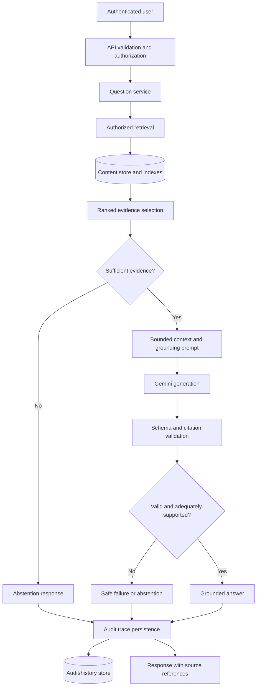

# ContextTrace AI — Architecture

**Status:** Proposed target architecture; reconcile with the existing repository audit before implementation.

## 1. Architecture principles

1. Retrieval, generation, verification, and audit persistence have separate responsibilities.
2. Authorization is applied before evidence is exposed to the model.
3. Retrieved documents are untrusted data and cannot override system policy.
4. Model output is untrusted until parsed and validated.
5. Source traces preserve the evidence available at generation time.
6. Every failure mode has explicit behavior; no silent fallback to ungrounded answers.
7. Architecture changes must be justified by repository findings and tests.

## 2. Logical request flow



This diagram is a target design, not proof that the current code implements these components.

## 3. Suggested module boundaries

Adapt names to the repository's existing conventions rather than creating duplicate layers.

- **API/controller layer:** HTTP parsing, authentication context, request validation, status codes.
- **Authorization policy:** checks access to documents, source excerpts, and history records.
- **Ingestion service:** normalizes input, validates metadata, manages document versions, and initiates indexing.
- **Content repository:** encapsulates database operations and access-scoped queries.
- **Retrieval service:** executes lexical, vector, or hybrid search; applies ranking and result limits.
- **Context builder:** selects and formats evidence within configured context limits.
- **LLM provider adapter:** calls Gemini, applies timeouts, parses provider errors, and tracks model/configuration identifiers.
- **Answer verifier:** validates output schema, citation references, and evidence sufficiency signals.
- **Audit service:** records the request, retrieved evidence snapshot, generated output, and verification result.
- **Evaluation harness:** runs a stable query set and calculates retrieval and answer-quality metrics.
- **Frontend:** renders answers, source excerpts, empty states, errors, and authorized history.

Do not split modules merely to match this list if the current codebase is small. Enforce the responsibilities first.

## 4. Data model concepts

The exact schemas must be based on the repository audit. The following are logical entities.

### Content document
- `id`: stable identifier.
- `tenantId` / `ownerId`: authorization scope where applicable.
- `title`: validated display title.
- `content`: normalized content or reference to stored content.
- `version`: monotonically increasing or otherwise unambiguous version.
- `contentHash`: hash of canonical content, where useful.
- `status`: ingestion/indexing status.
- `createdAt`, `updatedAt`.
- `classification` / `accessPolicy`: only if required by the product's access model.

### Answer trace
- `id`, `requestId`, `actorId`, and `tenantId` where applicable.
- `question`: apply retention and privacy policy.
- `answer` or explicit abstention/error status.
- `sources[]`: document ID, version, title snapshot, passage ID or offsets, excerpt snapshot, and content hash where appropriate.
- `retrieval`: strategy/version, parameters, ranked source IDs, and scores when meaningful.
- `generation`: provider/model identifier, prompt-template version, relevant settings, and timestamps.
- `verification`: schema status, citation-validation status, evidence-sufficiency outcome, and verifier version.
- `createdAt`, status, and failure stage where applicable.

Do not store secrets in traces. Avoid logging full private content unless the documented audit policy explicitly requires it and access/retention protections are in place.

## 5. Source trace and consistency

- A source title alone is not sufficient evidence.
- Preserve exact excerpts or an immutable, versioned reference that can reconstruct the excerpt.
- Record document version at retrieval time; current document contents may later change.
- If source content is deleted, define how retention and audit requirements interact. Do not silently rewrite historical traces.
- Validate all source references against the actual evidence supplied to generation.
- Define behavior if trace persistence fails. A successful answer must not be labeled fully auditable unless the required trace has been committed.
- Consider a transaction or durable outbox only if the database and workflow require it; avoid unnecessary distributed infrastructure for the MVP.

## 6. Retrieval strategy

### Baseline
Use the existing lexical/text retrieval if the audit confirms it is implemented correctly. Record a baseline on a labeled query set.

### Improvements
1. Validate query inputs and scope queries to authorized content.
2. Retrieve more candidates than are ultimately passed to the model when appropriate.
3. Rank and filter candidates using measured criteria.
4. Select bounded passages rather than concatenating unlimited documents.
5. Preserve ranking data and the exact selected evidence.
6. Evaluate empty, ambiguous, contradictory, stale, and out-of-scope queries.

### Optional semantic/hybrid retrieval
Add embeddings and vector search only when evaluation shows a meaningful gap in lexical retrieval. Version embedding model/configuration and index assumptions. Evaluate Recall@K and latency/cost before and after the change. Do not claim vector or hybrid retrieval until implemented and tested.

## 7. Generation and verification contract

Prefer a structured response such as:

```json
{
  "answer": "Answer text or a concise abstention message",
  "citations": [
    {
      "sourceId": "retrieved-source-id",
      "passageId": "retrieved-passage-id"
    }
  ],
  "insufficientEvidence": false
}
```

This is an illustrative contract. Adapt to the provider's structured-output capabilities and existing code.

Validation responsibilities:
- Parse the response against a strict schema.
- Reject citations not present in the supplied evidence set.
- Resolve displayed excerpts from trusted stored evidence, not model-generated text.
- Treat `insufficientEvidence` as a signal, not proof of correctness.
- Avoid presenting unsupported claims as verified.
- Return explicit safe statuses for malformed output, provider failure, empty retrieval, and verification failure.

Citation validity and factual support are different checks. The evaluation suite must assess whether cited evidence actually supports claims.

## 8. Security boundaries

- Authentication identifies the caller; authorization controls every document and trace read.
- Apply tenant/owner scope in the database query itself, not only in the UI.
- Do not expose API keys or internal prompts to the browser.
- Validate inputs, impose size limits, rate-limit costly endpoints, and configure timeouts.
- Treat document contents as untrusted; test indirect prompt injection and data-exfiltration attempts.
- Do not let the model select arbitrary database queries, invoke privileged tools, or bypass authorization.
- Keep logs useful but minimize sensitive data.
- Use secure cookies or an appropriate token strategy based on the existing app and deployment model.

## 9. Observability and failure behavior

Track request IDs, stage durations, retrieval counts, provider errors, verification status, and audit-write outcome. Do not log secrets. Full question/context logging must be a deliberate privacy decision.

Expected failure categories:
- invalid request;
- unauthenticated or unauthorized;
- no matching evidence;
- insufficient or conflicting evidence;
- provider timeout/rate limit/failure;
- malformed model output;
- citation/verification failure;
- database failure;
- audit persistence failure.

Map these to consistent safe API responses without exposing stack traces or sensitive internals.

## 10. Deployment topology

Use environment-specific configuration for frontend, API, MongoDB, and Gemini. Keep provider credentials server-side. Configure HTTPS, CORS allowlists, request limits, health checks, and safe error handling. Document backup, restore, retention, and key-rotation procedures appropriate to the hosting environment.

Do not choose additional queues, caches, vector databases, or microservices without a measured need.

## 11. Architecture decision records

For significant changes, record:
- context/problem;
- options considered;
- decision;
- security/privacy implications;
- migration/rollback plan;
- tests and measurements required.

The existing repository audit and current deployment constraints take precedence over this proposed target architecture.
